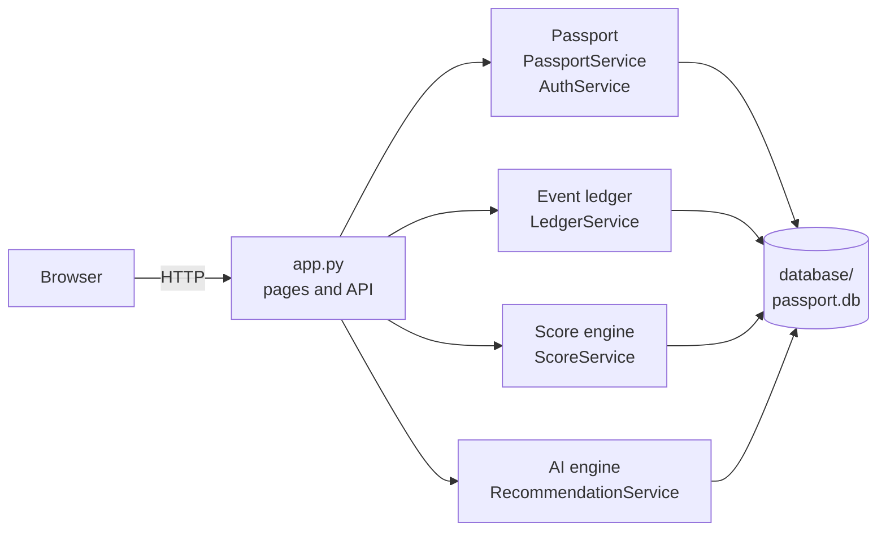
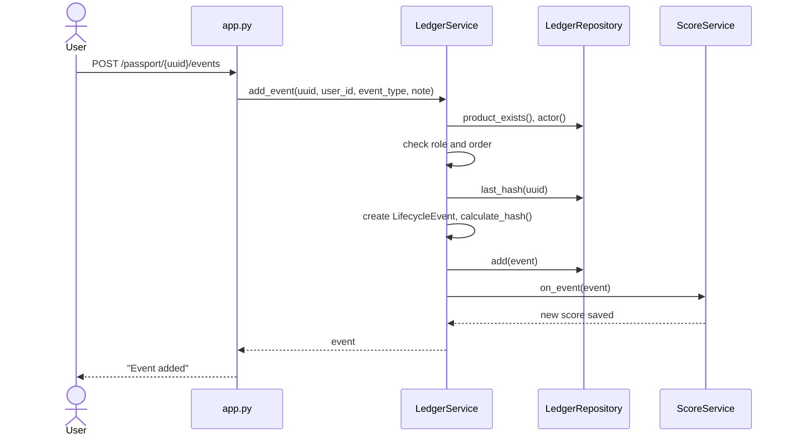
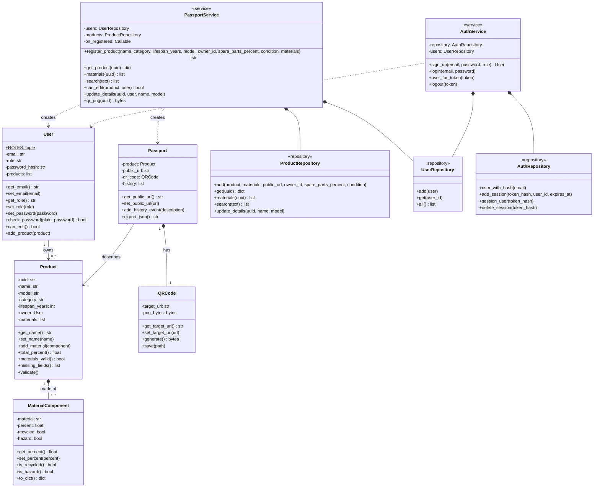
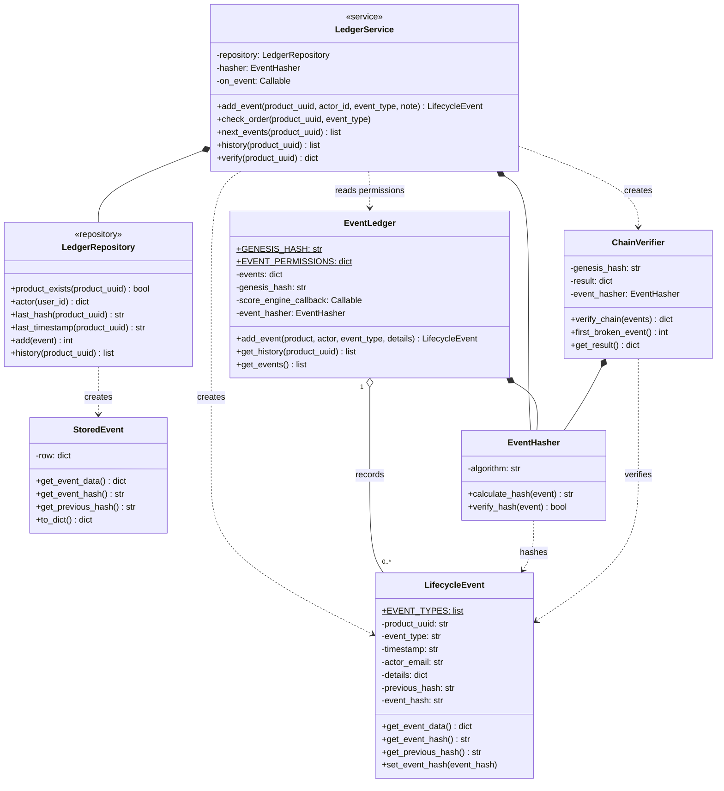
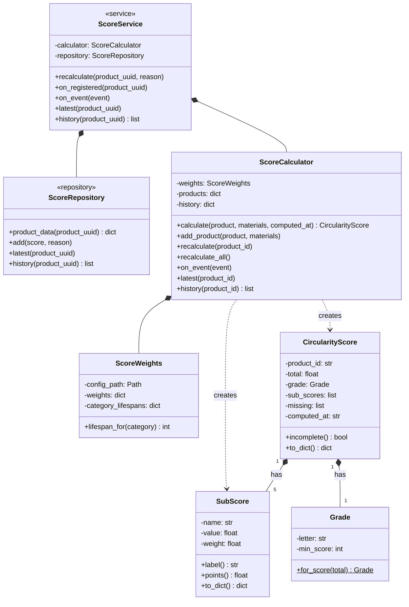
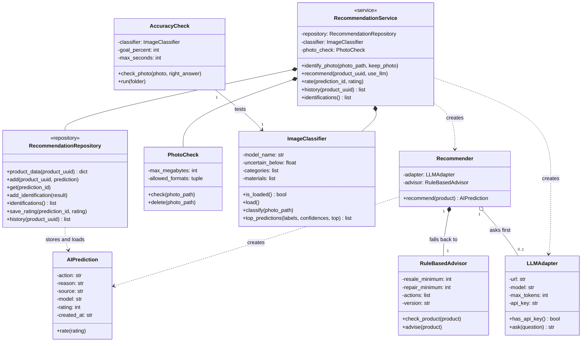

# AI-Powered Circular Economy Product Passport

[](https://github.com/pradnya-shinde001/group15-circular-product-passport/actions/workflows/tests.yml)


A digital passport for electronic products: a unique identity and QR code, a tamper-evident lifecycle history, a circularity score, and an AI engine that recognises products from a photo and advises what to do with them.


## 1. Team and Responsibilities

| Name | Matriculation No. | Subsystem | Main features | Folder |
| ---- | ----------------- | --------- | ------------- | ------ |
| Mosaddeka Mallick | 7226235 | Passport, QR code and web UI | Accounts and roles, product registration with materials, unique passport with QR code, search, editing name and model | [subsystem1_passport](subsystem1_passport/) |
| Anishkumar Sukumar | 7226163 | Event ledger | Lifecycle events (manufactured, sold, used, repaired, refurbished, recycled) recorded by permitted roles in real-life order, linked by SHA-256 hashes so any change is detected, append-only history, chain verification | [subsystem2_ledger](subsystem2_ledger/) |
| Rajib Munshi | 7225913 | Circularity score engine | Score from 0 to 100 and a grade from five sub-scores, recalculated after every event | [subsystem3_score](subsystem3_score/) |
| Pradnya Shinde | 7226048 | AI engine | Product recognition from a photo (CLIP), repair, resale, reuse or recycling advice (LLM with rule-based fallback), user ratings | [subsystem4_ai_engine](subsystem4_ai_engine/) |

## Project Demonstration Video

[Demonstration video](https://drive.google.com/file/d/14slt4f9fq5XE8N5p-PykLuiCyrFBE7Dd/view?usp=drive_link)

---

## 2. System Design

### 2.1 Architecture



- `app.py` and `templates/` are the web app. It has no business rules and no SQL; every page asks one of the subsystems.
- All four subsystems save their data in one shared SQLite database. Each subsystem has a `*_repository.py`, which saves and loads its data, and a `*_service.py`, which does its work with its classes.
- The web app is the only entry point. It talks to each subsystem **only through its service class** (the interface). The subsystems never import each other; `app.py` connects them by passing a callback into the constructor.
- Interaction between subsystems (callbacks set in `app.py`):
  - `PassportService(on_registered=ScoreService.on_registered)`: a new product gets its first score.
  - `LedgerService(on_event=ScoreService.on_event)`: every saved lifecycle event recalculates the score.
  - `RecommendationService` reads the product and score data through its own repository.

#### Interaction: adding a lifecycle event



### 2.2 Class Diagrams

Notation: `+` public, `-` private, underline = static, `*--` composition, `o--` aggregation, `-->` association, `..>` dependency, `<|--` inheritance. Every subsystem is used through one service class (marked `<<service>>`), which is its interface. Repositories (`<<repository>>`) are the only classes that run SQL.

#### Passport

**Purpose:** Registers users and products, creates the digital passport and QR code, and controls who may edit.
**Interface:** `PassportService` (`register_product`, `get_product`, `search`, `update_details`, `qr_png`) and `AuthService` (`sign_up`, `login`, `user_for_token`, `logout`).



#### Event Ledger

**Purpose:** Keeps a tamper-evident, append-only history of a product's life. Each event stores the hash of the previous one, so any change is detected.
**Interface:** `LedgerService` (`add_event`, `check_order`, `next_events`, `history`, `verify`). It checks the actor's role and the event order and raises a `LedgerError` with an HTTP code when a rule is broken.



#### Score Engine

**Purpose:** Calculates the circularity score (0-100) and grade from the product data and keeps the score history.
**Interface:** `ScoreService` (`recalculate`, `on_registered`, `on_event`, `latest`, `history`).



#### AI Engine

**Purpose:** Identifies a product from a photo and recommends an end-of-life action (repair, resell, recycle...); falls back to rules when the LLM is unavailable.
**Interface:** `RecommendationService` (`identify_photo`, `recommend`, `rate`, `history`, `identifications`).




### 2.3 Database

All four subsystems share one SQLite database, `database/passport.db`. The tables are defined in [database/schema.sql](database/schema.sql), and [database/connection.py](database/connection.py) creates them when the app starts. Set `PASSPORT_DB` to use another file; Docker uses `/data/passport.db`, and the tests use a temporary file.


| Table | Subsystem | What it holds |
| ----- | --------- | ------------- |
| `users` | 1. Passport | Email, role and salted password hash (never the password) |
| `sessions` | 1. Passport | Login sessions: SHA-256 of the token, user and expiry time |
| `products` | 1. Passport | UUID, name, model, category, lifespan, spare parts %, condition, owner, QR code address |
| `material_components` | 1. Passport | Each material of a product with its %, and whether it is recycled, recyclable or hazardous |
| `lifecycle_events` | 2. Event ledger | Each event with its time, who recorded it, details (JSON), previous hash and own hash |
| `circularity_scores` | 3. Score engine | Every score ever calculated: total, grade, five sub-scores (JSON), missing data and the reason, e.g. `event: repaired` |
| `ai_predictions` | 4. AI engine | Each recommendation: action, reason, source (LLM or rules), model and the user's rating (1–5) |
| `photo_identifications` | 4. AI engine | Each photo identification: category and material with their confidence, and the model used |


**Demo data:** On its first start, the app fills an empty database with synthetic data from [database/seed.py](database/seed.py): the 4 demo users and 100 products, each with materials, a lifecycle history from 2021 to 2025, scores and a recommendation. The data goes in through each subsystem's own service, so every rule is checked. A fixed random seed gives the same products every time.

```bash
python -m database.seed               # delete and recreate the database with 100 products
python -m database.seed --count 250   # with another number of products
```

The `/database` page shows every table with its rows, read live. The `.db` files are not committed to Git (see `.gitignore`).

## 3. Run it

Tested with Python 3.14. Run every command from the project folder.

### With Docker

```bash
docker compose up --build                  # without photo identification (small image)
INSTALL_CLIP=1 docker compose up --build   # with CLIP for photo identification (about 2 GB)
```

Open http://localhost:8000. Stop with `Ctrl+C` or `docker compose down`. The database is kept in a Docker volume, and the API key is read from `.env` when the container starts.

### Without Docker

```bash
python3 -m venv venv
source venv/bin/activate          # Windows: venv\Scripts\activate
pip install -r requirements.txt
uvicorn app:app --reload
```

Open http://localhost:8000 for the pages and http://localhost:8000/docs for the API. On its first start, the app creates the database with demo data. To rebuild it, stop the app and run `python -m database.seed`.

### AI advice with KI:connect (optional)

Copy `.env.example` to `.env` and enter your key (`KICONNECT_API_KEY=...`). Without a key, the AI engine automatically uses its rules.

## 4. Demo Accounts and Pages

Reading passports is public. To register a product, record an event or get an AI recommendation, log in at `/login`. The demo accounts use the password `demo-password`.

| Email | May do |
| ----- | ------ |
| `admin@example.com` | Register products, edit any product, record every event type |
| `manufacturer@example.com` | Register products, edit its own products; record manufactured, sold, repaired, refurbished |
| `recycler@example.com` | Record refurbished, recycled |
| `consumer@example.com` | Record sold, used, repaired |

| Address | What it shows |
| ------- | ------------- |
| `/` | Search products, with their latest score and grade |
| `/login`, `/signup` | Log in, or create an account |
| `/register` | Register a product and its materials, optionally filled in from a photo |
| `/passport/{uuid}` | Product, QR code, score, lifecycle history, AI recommendation |
| `/passport/{uuid}/edit` | Change the product's name and model |
| `/database` | Every table with its rows, read live |
| `/api/products` | All products as JSON |
| `/api/passports/{uuid}`, `/events`, `/verify`, `/scores` | The passport, its event history, chain check and score history as JSON |

## 5. Error Handling

Each subsystem has an `errors.py` with one base class and smaller classes for each kind of problem, so other code can catch all errors of a subsystem with one `except`, or only one kind. Most classes also inherit from a built-in error (`ValueError`, `LookupError` or `PermissionError`), so the web app shows a clear message or a "Not found" page instead of crashing.

| Subsystem | Base class | Error classes |
| --------- | ---------- | ------------- |
| 1. Passport | `PassportError` | `AccountError`, `RegistrationError`, `ProductEditError`, `NotAllowedError`, `ProductNotFoundError` |
| 2. Event ledger | `LedgerError` | `ProductNotFoundError` (404), `EventNotPermittedError` (403), `InvalidEventError` (400), `InvalidEventOrderError` (409), `ChainConflictError` (409), `LedgerDatabaseError` (500). Each error carries its own message and HTTP status code. If the score engine fails after an event is saved, the failure is logged and the event is kept |
| 3. Score engine | `ScoreError` | `ProductNotFoundError`, `InvalidScoreDataError`, `InvalidConfigError` (and `ScoreErrorHandler`, which hides internal details) |
| 4. AI engine | `AIEngineError` | `ProductNotFoundError`, `InvalidProductError`, `InvalidPhotoError`, `InvalidRatingError`, `PredictionNotFoundError`, `LLMError` (caught by the `Recommender`, which then uses the rules) |

## 6. Tests

### All tests

```bash
python -m pytest -v                                 # 88 tests
```

### Each subsystem

Run one file with `python -m pytest tests/<file> -v`, for example `python -m pytest tests/test_subsystem1.py -v`.

| File | Tests | What they check |
| ---- | ----- | --------------- |
| `test_subsystem1.py` | 31 | Sign-up, login and roles; product registration with UUID, passport and QR code; materials total 100%; search; JSON export; password hashing; account lock; page speed; API documentation |
| `test_subsystem2.py` | 14 | Roles and event order; hash chain and tamper detection; same hash for same data; corrections as new events; concurrent events; speed; link to the score engine; error classes |
| `test_subsystem3_score.py` | 15 | Score and grade; the five sub-scores; missing data; score stays between 0 and 100; same result every time; score after a repair; score saved when a product is registered; error handling |
| `test_subsystem4_ai_engine.py` | 28 | Rules and LLM fallback; LLM reason; ratings; photo checks and identification; accuracy check; error handling |

### Test coverage

```bash
python -m pytest --cov                           # with test coverage
python -m pytest --cov --cov-report=html         # coverage as a web page: open htmlcov/index.html
```

The tests use a temporary database, so they never change `database/passport.db`. They replace the real LLM and CLIP with small fake classes, so they need no internet and no API key.

**Continuous integration:** GitHub Actions (`.github/workflows/tests.yml`) runs all tests with coverage on every push and pull request, and checks that the Docker image still builds. The badge at the top shows the latest result.

## 7. Class Documentation

Every class has docstrings. Each subsystem's classes, with their methods, getters and setters, can be read with `pydoc` (press `q` to close it):

```bash
python -m pydoc subsystem1_passport
python -m pydoc subsystem2_ledger
python -m pydoc subsystem3_score
python -m pydoc subsystem4_ai_engine
```

## 8. Limitations

- Runs locally over HTTP with SQLite, so it suits a demo, not many users at once.
- Demo data is synthetic, and the score weights are our own choice, not an official standard.
- Photo identification knows only 10 categories and 6 materials.
- AI advice from the LLM needs a KI:connect key and internet; otherwise the simpler rules are used.
