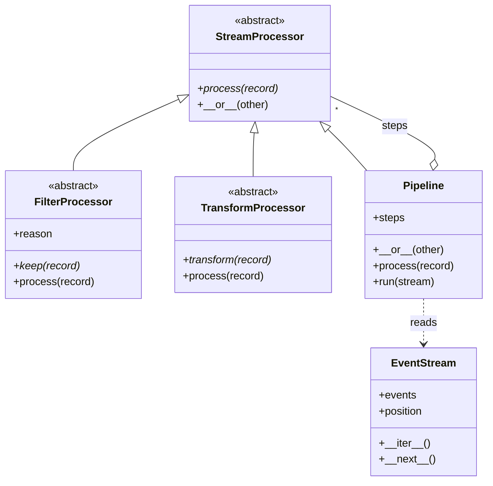
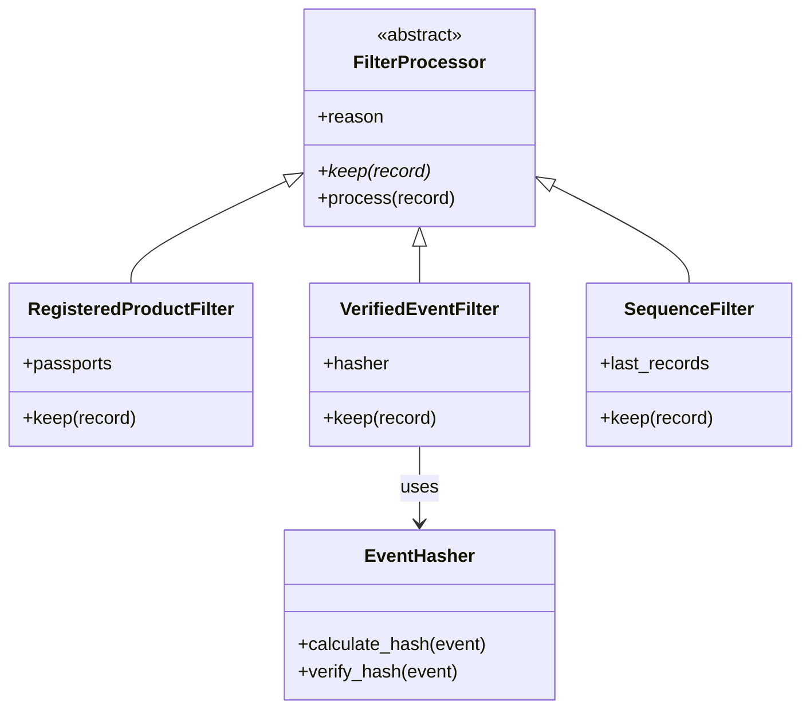
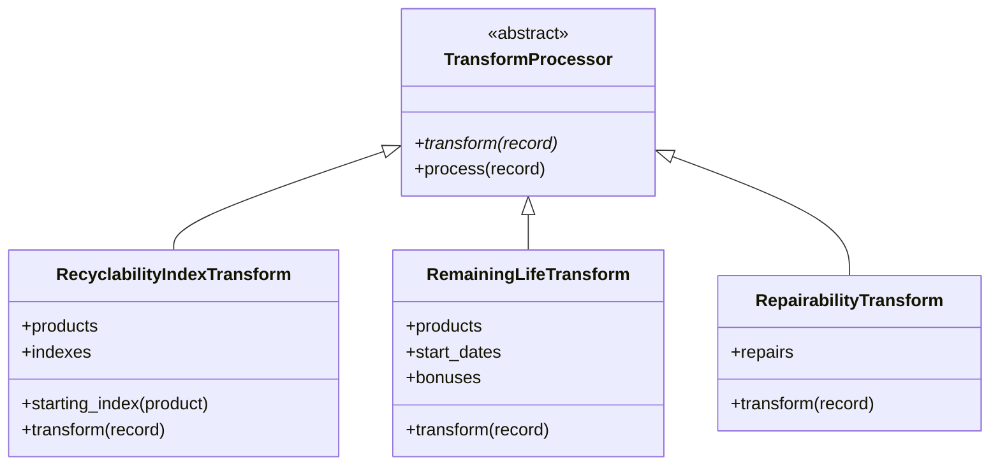
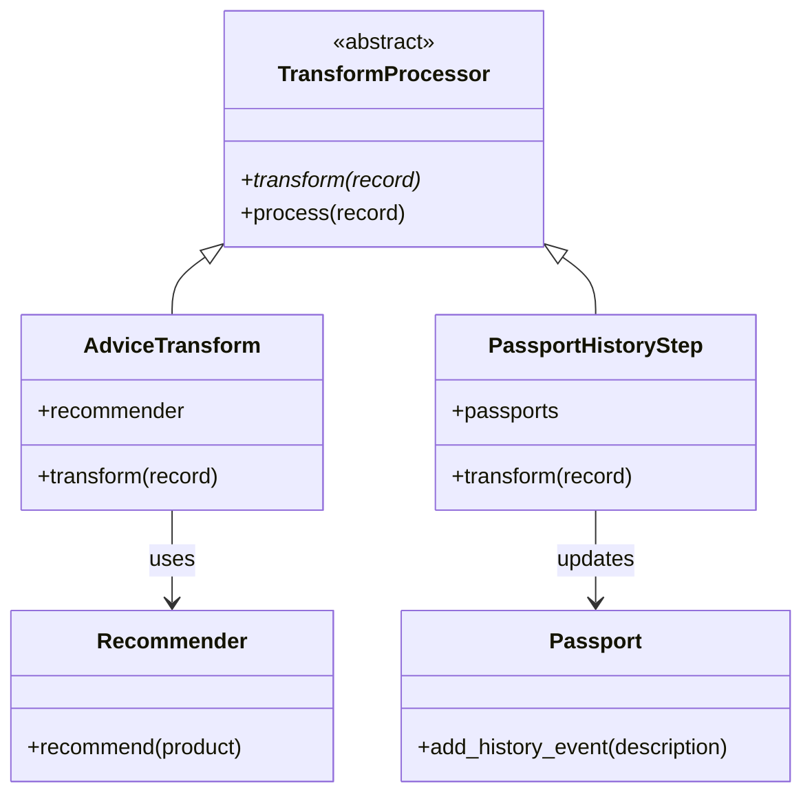

# AI-Powered Circular Economy Product Passport

Group 15, Capstone Project, FH Dortmund. This branch contains Homework Assignment 2. The Homework Assignment 1 details and class diagrams are on the `Homeworkassignment001` branch.

## Team Overview

| Team member        | Subsystem                                | Folder                                        |
| ------------------ | ---------------------------------------- | --------------------------------------------- |
| Mosaddeka Mallick  | 1. Passport, QR code and web UI          | [subsystem1_passport](subsystem1_passport/)   |
| Anishkumar Sukumar | 2. Event ledger (tamper-evident history) | [subsystem2_ledger](subsystem2_ledger/)       |
| Rajib Munshi       | 3. Circularity score engine              | [subsystem3_score](subsystem3_score/)         |
| Pradnya Shinde     | 4. AI engine (advice)                    | [subsystem4_ai_engine](subsystem4_ai_engine/) |

## Homework Assignment 2: Stream Processing Pipeline

**5-minute video:** [Link to the video](https://drive.google.com/file/d/1-0lijA2r9SuJ-EVze463hP_Z_T0hzpA9/view?usp=sharing)

The pipeline ingests lifecycle events from across a product's supply chain, one at a time, and does two things:

1. **Filter:** drops events that are unverified or out of sequence.
2. **Transform:** turns the verified events into a dynamic Recyclability Index and the percentage of functional life remaining.

Run it from the project folder (tested with Python 3.14):

```bash
python3 -m venv venv
source venv/bin/activate          # Windows: venv\Scripts\activate
pip install -r requirements.txt
python -m stream_core.demo
```

No API key is needed, because the advice step uses the rule-based advisor.

### Expected output

The demo sends in 11 events and 6 come out. The 5 dropped events are a forged hash, an event dated too early, a duplicate, a product with no passport, and a product that was never manufactured.

```text
Events in: 11

manufactured  2020-01-15  Recyclability: 70.0   Life left: 100     Advice: Resale
sold          2020-02-01  Recyclability: 70.0   Life left: 99.2    Advice: Resale
used          2021-01-10  Recyclability: 69.0   Life left: 83.5    Advice: Resale
   Dropped repaired: unverified, hash does not match
   Dropped repaired: out of sequence
   Dropped sold: out of sequence
   Dropped manufactured: product has no passport
repaired      2023-03-10  Recyclability: 71.0   Life left: 52.5    Advice: Reuse
refurbished   2024-06-01  Recyclability: 76.0   Life left: 52.0    Advice: Reuse
recycled      2026-02-20  Recyclability: 76.0   Life left: 0       Advice: None
   Dropped sold: out of sequence

Events out: 6
```

### Where each OOP concept is used

All of these are in `stream_core/processors.py`.

| Concept                      | Where                                                                          |
| ---------------------------- | ------------------------------------------------------------------------------ |
| Abstract base classes        | `StreamProcessor`, `FilterProcessor`, `TransformProcessor`                     |
| Inheritance and polymorphism | Every step has `process()`, and `Pipeline.process()` calls them the same way   |
| Operator overloading         | `__or__` joins steps: `step_a \| step_b`                                       |
| Iterators and generators     | `EventStream` has `__iter__` and `__next__`, and `Pipeline.run()` uses `yield` |

### What each subsystem adds

| Subsystem    | File                                    | Steps                                                                             |
| ------------ | --------------------------------------- | --------------------------------------------------------------------------------- |
| 1. Passport  | `subsystem1_passport/stream_steps.py`   | `RegisteredProductFilter`, `PassportHistoryStep`                                  |
| 2. Ledger    | `subsystem2_ledger/stream_filters.py`   | `VerifiedEventFilter`, `SequenceFilter`                                           |
| 3. Score     | `subsystem3_score/stream_transforms.py` | `RecyclabilityIndexTransform`, `RemainingLifeTransform`, `RepairabilityTransform` |
| 4. AI engine | `subsystem4_ai_engine/stream_advice.py` | `AdviceTransform`                                                                 |

### Formulas

The numbers below are assumptions and can be changed in `subsystem3_score/stream_transforms.py`.

- **Recyclability Index** = recyclable share of the materials, then -1 for `used`, +2 for `repaired` and +5 for `refurbished`, kept between 0 and 100.
- **Remaining life %** = 100 - (years since manufacture / lifespan x 100), then +5 for each `repaired` and +20 for each `refurbished`, kept between 0 and 100. It becomes 0 when the product is `recycled`.

### Class diagrams

Each diagram reads from top to bottom: the abstract class, then the steps that inherit from it, then the classes those steps use.

#### 1. Framework (`stream_core/processors.py`)



#### 2. Filter steps (Subsystems 1 and 2)



#### 3. Score transform steps (Subsystem 3)



#### 4. Advice and passport transform steps (Subsystems 4 and 1)



## Homework Assignment 3: Web API and Database Access Layer

### Subsystem 1: Passport, QR code and web UI (Mosaddeka Mallick)

FastAPI web app with a SQLite database (Python's `sqlite3`). Use Python 3.11 or newer: on a Mac, create the venv with `python3.14 -m venv venv`, because the default `python3` is 3.9.

```bash
pip install -r requirements.txt
python -m subsystem1_passport.seed
uvicorn subsystem1_passport.app:create_app --factory --reload
```

- Web UI: http://localhost:8000 (search, public passport page, product registration)
- API docs (OpenAPI): http://localhost:8000/docs
- Demo logins (password `demo-pass-123`): `admin@demo.local`, `maker@demo.local`, `recycler@demo.local`, `consumer@demo.local`

**Database tables:** `users`, `products`, `material_components`, `qr_codes`, `history_events`. Every product is identified by `products.uuid`, which the other subsystems use to refer to a product. Database triggers prevent deleting products and changing history (no hard deletes).

**Access layer:** `subsystem1_passport/database.py` (schema and connections) and `subsystem1_passport/repository.py` (all SQL queries). The web pages and the API only call the repository.

Details, settings and the list of requirements: [subsystem1_passport/README.md](subsystem1_passport/README.md)
