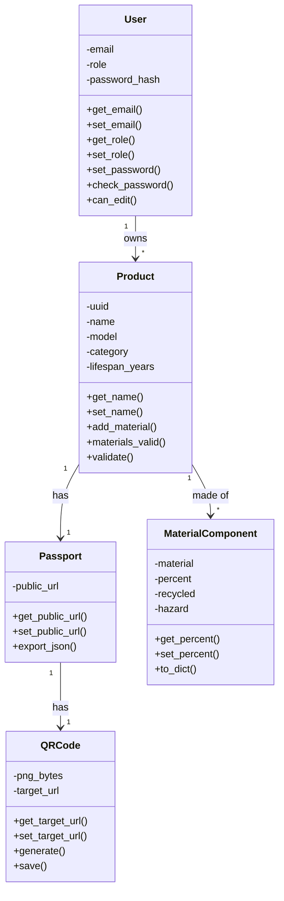
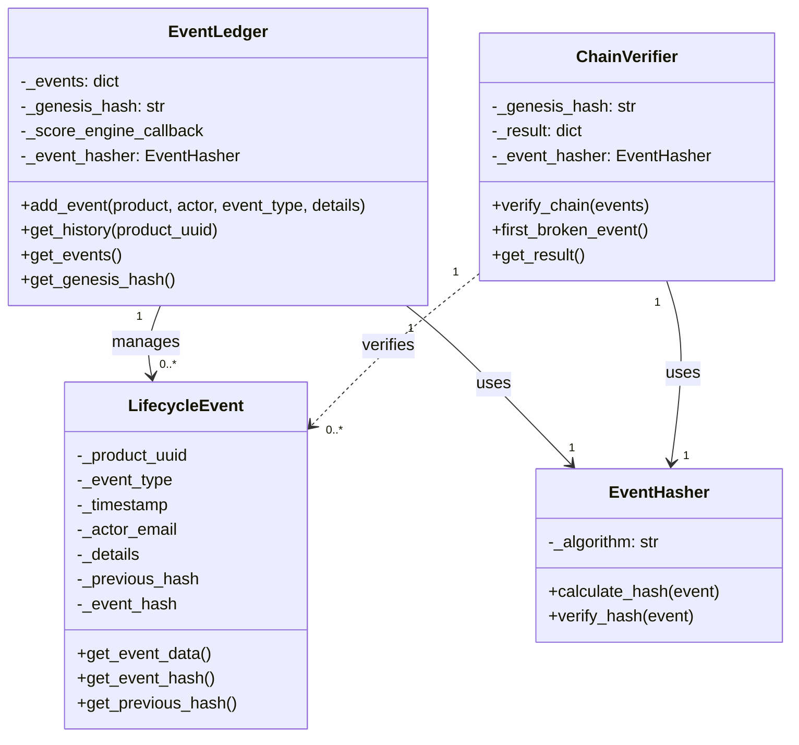
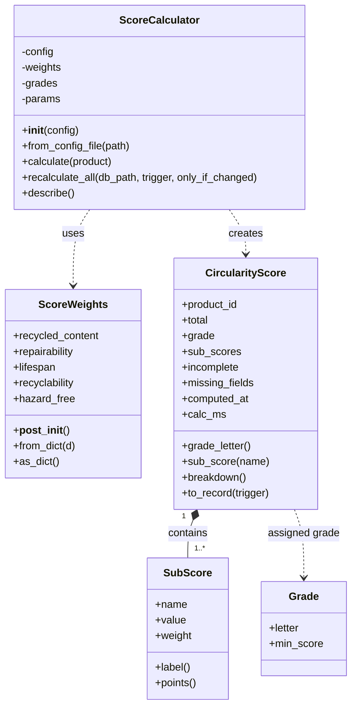
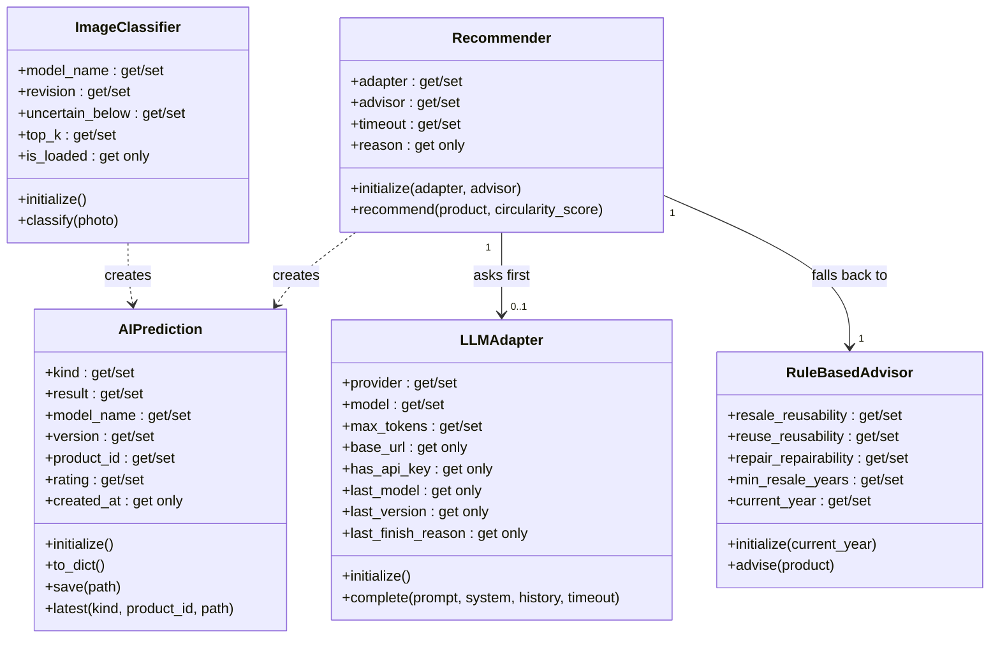

# AI-Powered Circular Economy Product Passport

Group 15, Capstone Project, FH Dortmund. A digital passport for electronic products: a unique QR-based identity, a tamper-evident lifecycle history, a circularity score, and AI identification and advice.

Each homework assignment has its own branch. The classes are added there.

## Team Overview

| Team member        | Subsystem                                | Folder                                        |
| ------------------ | ---------------------------------------- | --------------------------------------------- |
| Mosaddeka Mallick  | 1. Passport, QR code and web UI          | [subsystem1_passport](subsystem1_passport/)   |
| Anishkumar Sukumar | 2. Event ledger (tamper-evident history) | [subsystem2_ledger](subsystem2_ledger/)       |
| Rajib Munshi       | 3. Circularity score engine              | [subsystem3_score](subsystem3_score/)         |
| Pradnya Shinde     | 4. AI engine (identification and advice) | [subsystem4_ai_engine](subsystem4_ai_engine/) |

## Presentation Link

**Team video:** the link will be added here.

## Run it

Tested with Python 3.14. Run every command from this folder.

```bash
python3 -m venv venv
source venv/bin/activate          # Windows: venv\Scripts\activate
pip install -r requirements.txt
```

To read the description of each subsystem's classes, with their methods, getters and setters (press `q` to close it):

```bash
python -m pydoc subsystem1_passport
python -m pydoc subsystem2_ledger
python -m pydoc subsystem3_score
python -m pydoc subsystem4_ai_engine
```

Each folder's `__init__.py` lists its classes, which is why these commands can show them.

Each subsystem has a demo that creates its objects, uses their getters and setters, and prints the results:

```bash
python -m subsystem1_passport.demo
python -m subsystem2_ledger.demo
python -m subsystem3_score.demo
python -m subsystem4_ai_engine.demo
```

The demos need no API key and no extra setup. Each subsystem runs on its own.

### Optional: the real AI

The Subsystem 4 demo uses the rule-based advisor and does not load the CLIP image model. To identify a real photo with CLIP, install its large packages and give the demo a photo. The first run also downloads the model.

```bash
pip install -r requirements-clip.txt
python -m subsystem4_ai_engine.demo path/to/photo.jpg
```

To use the LLM, set an API key from https://chat.kiconnect.nrw as an environment variable. The key is never stored in the code.

```bash
export KICONNECT_API_KEY="your-key"
```

## System Design

### Subsystem 1: Passport, QR code and web UI

### Classes: `User`, `Product`, `MaterialComponent`, `Passport`, `QRCode`.



### Subsystem 2: Event Ledger

### Classes: `EventLedger`, `LifecycleEvent`, `EventHasher`, `ChainVerifier`



### Subsystem 3: Circularity score engine
### Classes: ScoreCalculator, ScoreWeights, CircularityScore, Subscore and Grade




### Subsystem 4: AI engine


