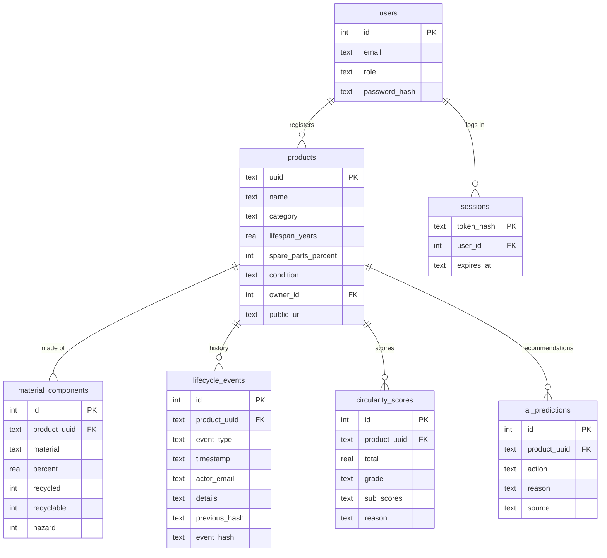

# AI-Powered Circular Economy Product Passport

Group 15, Capstone Project, FH Dortmund.
**Homework Assignment 3:** a web app on a shared database for all four subsystems.

A digital passport for electronic products: a unique identity and QR code, a tamper-evident lifecycle history, a circularity score and AI advice.

## Team

| Team member        | Subsystem                                | Folder                                        |
| ------------------ | ---------------------------------------- | --------------------------------------------- |
| Mosaddeka Mallick  | 1. Passport, QR code and web UI          | [subsystem1_passport](subsystem1_passport/)   |
| Anishkumar Sukumar | 2. Event ledger (tamper-evident history) | [subsystem2_ledger](subsystem2_ledger/)       |
| Rajib Munshi       | 3. Circularity score engine              | [subsystem3_score](subsystem3_score/)         |
| Pradnya Shinde     | 4. AI engine (advice)                    | [subsystem4_ai_engine](subsystem4_ai_engine/) |

**Video:** the link will be added here.

## What we built

All four subsystems save their data in **one shared database**, and a **web app** shows that data as web pages and as a JSON API.

- The web app uses **FastAPI**.
- The database is **SQLite**, using Python's built-in `sqlite3`. It needs no database server: the whole database is one file, `database/passport.db`.

## Run it

Tested with Python 3.14. Run every command from the project folder.

```bash
python3 -m venv venv
source venv/bin/activate          # Windows: venv\Scripts\activate
pip install -r requirements.txt
uvicorn app:app --reload
```

Open http://localhost:8000 for the web pages, and http://localhost:8000/docs for the API documentation. Press `Ctrl+C` to stop.

On its first start, the app creates the database and fills it with demo data. To start again from fresh demo data, stop the app and run:

```bash
python -m database.seed               # 100 products
python -m database.seed --count 250   # or another number
```

This deletes `database/passport.db`, including any products you registered yourself, and builds it again.

### Optional: AI advice from the LLM

Without a key, the AI engine uses its rule-based advisor. To use the college LLM (KI:connect.NRW) instead:

1. Log in at https://chat.kiconnect.nrw, click your name at the bottom left, and create a key under API key management.
2. Copy `.env.example` to `.env` and replace `your-key` with your key.

Git ignores `.env`, so the key is never committed.

## Logins

Reading passports is public. To register a product or record an event, log in at `/login`, or create your own account at `/signup` as a consumer, manufacturer or recycler. Admin accounts can't be created by signing up.

The demo data has four ready-made accounts. The password for all four is `demo-password`. These accounts are for the local demo only.

| Email | Role | May do |
| ----- | ---- | ------ |
| `admin@example.com` | admin | Register products, record every event type |
| `manufacturer@example.com` | manufacturer | Register products; record manufactured, sold, repaired, refurbished |
| `recycler@example.com` | recycler | Record refurbished, recycled |
| `consumer@example.com` | consumer | Record sold, used, repaired |

## Pages and API

| Address | What it shows | Login |
| ------- | ------------- | ----- |
| `/` | Search products, with each product's latest score and grade | |
| `/signup` | Create an account (consumer, manufacturer or recycler) and log in | |
| `/login` | Log in and log out | |
| `/register` | Register a product and its materials. A passport and QR code are created | manufacturer or admin |
| `/passport/{uuid}` | The passport: product, materials, QR code, score, lifecycle history, AI recommendation | Only to add an event |
| `/database` | Every table in the database with its rows, read live. Not in the menu: open it by its address | |
| `/api/products` | Search products, as JSON | |
| `/api/passports/{uuid}` | The whole passport, as JSON | |
| `/api/passports/{uuid}/verify` | Whether the event history is intact | |
| `/api/passports/{uuid}/scores` | Every score of a product | |

## How it is organised


- **`app.py`** has no business rules and no SQL. Every page asks one of the four subsystems.
- **Each subsystem** has two new files:
  - a **`*_repository.py`** that only saves and loads its data, and
  - a **`*_service.py`** that does the subsystem's work with its classes from Assignment 1.
- **The `database` folder** is shared. It opens the database and creates the tables, and holds no subsystem logic.
- **The subsystems don't import each other's code.** They work together through callbacks: registering a product (Subsystem 1) or adding an event (Subsystem 2) makes the score engine (Subsystem 3) calculate a new score.

| Folder or file | Assignment 3 files |
| -------------- | ------------------ |
| [app.py](app.py) and [templates](templates/) | The FastAPI app and its HTML pages |
| [database](database/) | `schema.sql` (all tables), `connection.py` (opens the database), `seed.py` (demo data) |
| [subsystem1_passport](subsystem1_passport/) | `passport_repository.py`, `passport_service.py` (register a product, passport, QR code), `auth_repository.py`, `auth_service.py` (login and logout) |
| [subsystem2_ledger](subsystem2_ledger/) | `ledger_repository.py`, `ledger_service.py` (add an event to the hash chain, verify the chain) |
| [subsystem3_score](subsystem3_score/) | `score_repository.py`, `score_service.py` (calculate and store the score) |
| [subsystem4_ai_engine](subsystem4_ai_engine/) | `recommendation_repository.py`, `recommendation_service.py` (recommend and store) |

## Database tables



| Subsystem | Tables |
| --------- | ------ |
| 1. Passport | `users`, `sessions`, `products`, `material_components` |
| 2. Event ledger | `lifecycle_events`: append-only, because database triggers refuse any change or deletion |
| 3. Score engine | `circularity_scores`: every score is kept, so the score history can be shown |
| 4. AI engine | `ai_predictions` |

Passwords are stored only as salted hashes, and login sessions only as a hash of the token. The Database page never shows the password hashes or the sessions table.

## Demo data

`database/seed.py` creates 4 users and 100 synthetic products in 10 categories. Each product gets:

- materials that add up to 100 %,
- a lifecycle history dated between 2021 and 2025,
- a score after registration and after every event, and
- one recommendation from the rule-based advisor.

The data goes in through each subsystem's service, so it passes the same checks as data entered on the web pages. A fixed random seed gives everyone the same products. Only the UUIDs differ, because the `Product` class creates a new one each time.

## What this assignment covers

Only part of the requirements is implemented so far.

| Subsystem | Done in Assignment 3 | Not done yet |
| --------- | -------------------- | ------------ |
| 1. Passport | Register a product with validation (required fields, materials sum to 100 %), unique UUID, passport page, QR code, JSON export, search, sign up and login with four roles | Editing or archiving a product |
| 2. Event ledger | Events recorded by the logged-in user, with a role check per event type, an order check (manufactured first and only once, nothing after recycled), a SHA-256 hash chain, an append-only table, and a chain check that finds the first broken event | Corrections of earlier events |
| 3. Score engine | A score on registration and after every event, five sub-scores and a grade, score history | Recalculating all products after a weight change, editable weights |
| 4. AI engine | A recommendation from the LLM if a key is set, otherwise from the rules; every recommendation is stored | Image identification, AI chat assistant, recycling guidance |

## Limits

- The demo data is synthetic.
- The category lifespans in `subsystem3_score/score_config.json` are working assumptions, not measured data.
- `database/passport.db` is not committed. Every computer builds its own copy on the first start.
