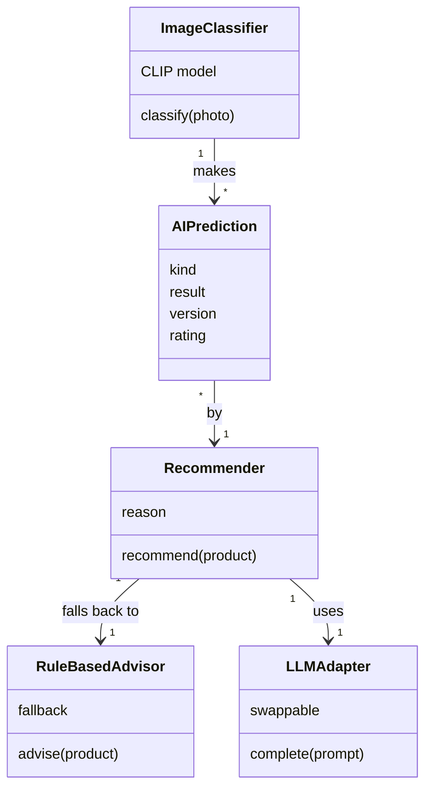

# AI-Powered Circular Economy Product Passport

Group 15, Capstone Project, FH Dortmund. A digital passport for electronic products: a unique QR-based identity, a tamper-evident lifecycle history, a circularity score, and AI identification and advice.

Each homework assignment has its own branch. The classes are added there.

## Team Overview

| Team member | Subsystem | Folder |
|---|---|---|
| Mosaddeka Mallick | 1. Passport, QR code and web UI | [subsystem1_passport](subsystem1_passport/) |
| Anishkumar Sukumar | 2. Event ledger (tamper-evident history) | [subsystem2_ledger](subsystem2_ledger/) |
| Rajib Munshi | 3. Circularity score engine | [subsystem3_score](subsystem3_score/) |
| Pradnya Shinde | 4. AI engine (identification and advice) | [subsystem4_ai_engine](subsystem4_ai_engine/) |

## Presentation Link

**Team video:** the link will be added here.

## System Design

### Subsystem 1: Passport, QR code and web UI
TODO

### Subsystem 2: Event ledger
TODO

### Subsystem 3: Circularity score engine
TODO

### Subsystem 4: AI engine

