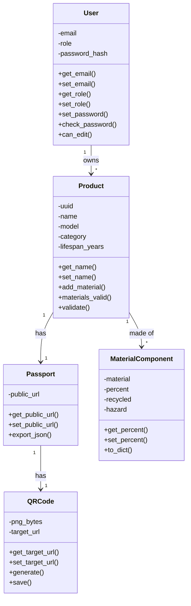
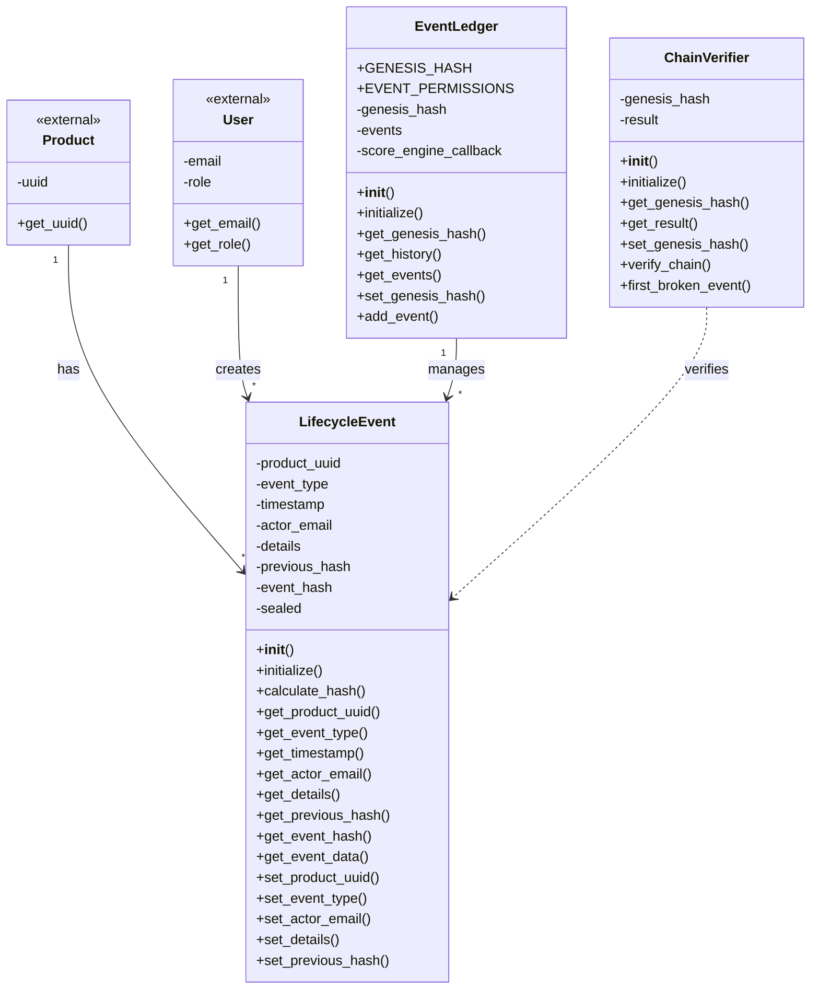
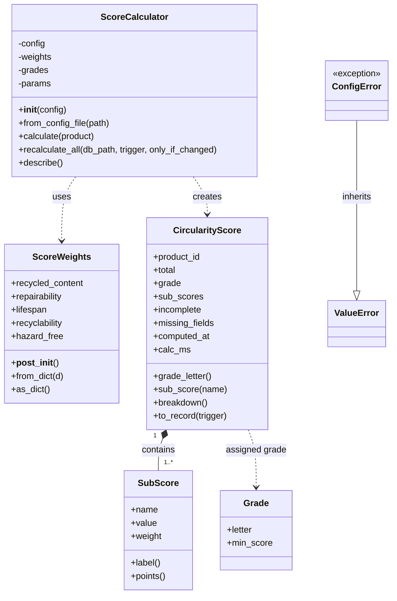
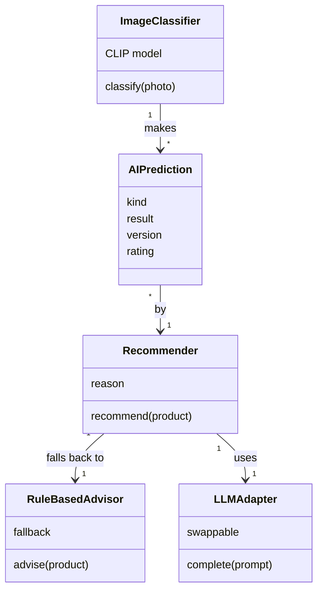

# AI-Powered Circular Economy Product Passport

Group 15, Capstone Project, FH Dortmund. A digital passport for electronic products: a unique QR-based identity, a tamper-evident lifecycle history, a circularity score, and AI identification and advice.

Each homework assignment has its own branch. The classes are added there.

## Team Overview

| Team member        | Subsystem                                | Folder                                        |
| ------------------ | ---------------------------------------- | --------------------------------------------- |
| Mosaddeka Mallick  | 1. Passport, QR code and web UI          | [subsystem1_passport](subsystem1_passport/)   |
| Anishkumar Sukumar | 2. Event ledger (tamper-evident history) | [subsystem2_ledger](subsystem2_ledger/)       |
| Rajib Munshi       | 3. Circularity score engine              | [subsystem3_score](subsystem3_score/)         |
| Pradnya Shinde     | 4. AI engine (identification and advice) | [subsystem4_ai_engine](subsystem4_ai_engine/) |

## Presentation Link

**Team video:** the link will be added here.

## System Design

### Subsystem 1: Passport, QR code and web UI

### Classes: `User`, `Product`, `MaterialComponent`, `Passport`, `QRCode`.

### Subsystem 2: Event Ledger

**Classes:** LifecycleEvent, EventLedger, ChainVerifier

### Subsystem 3: Circularity score engine

# Circularity Score Engine — UML Design

## 1. Subsystem overview

The **Circularity Score Engine (Subsystem 3)** evaluates a product's circularity using five weighted dimensions:

1. Recycled content
2. Repairability
3. Lifespan
4. Recyclability
5. Hazard-free materials

The engine calculates individual sub-scores, combines them into a total score, assigns a grade, and returns a structured result. It can also recalculate scores when product information changes.

> This document describes the UML structure of the Circularity Score Engine. Keep the class names and relationships aligned with the implementation in `circularity.py`.

## 2. Classes in the subsystem

| Class | Responsibility |
|---|---|
| `ScoreCalculator` | Main calculation component. Uses the configured weights and grading rules to calculate a product's circularity score. |
| `ScoreWeights` | Holds and validates the weights assigned to the five scoring dimensions. |
| `CircularityScore` | Represents the calculated result, including the total score, grade, sub-scores and missing-data information. |
| `SubScore` | Represents one scoring dimension, including its score and weight. |
| `Grade` | Represents a grade threshold and its corresponding grade letter. |
| `ConfigError` | Represents an invalid scoring-configuration error; inherits from Python's `ValueError`. |

## 3. UML class diagram

The following Mermaid class diagram can be rendered directly by GitHub in this Markdown file.

## 4. Class relationships

- **`ScoreCalculator` uses `ScoreWeights`:** the calculator reads the configured weights when calculating the weighted total.
- **`ScoreCalculator` creates `CircularityScore`:** after evaluating the product, it produces a result object.
- **`CircularityScore` contains `SubScore` objects:** each result includes the component scores used in the calculation.
- **`CircularityScore` references `Grade`:** the total score is mapped to a grade according to the configured thresholds.
- **`ConfigError` inherits from `ValueError`:** it provides a specific error type for invalid scoring configuration.

## 5. Scoring dimensions

The engine evaluates these five dimensions. The weights below reflect the current project scoring configuration described for this subsystem; if `score_config.json` changes, update this table to match it.

| Dimension | Weight |
|---|---:|
| Recycled content | 20% |
| Repairability | 25% |
| Lifespan | 20% |
| Recyclability | 25% |
| Hazard-free | 10% |
| **Total** | **100%** |

The weighted total is calculated from the five component scores and their configured weights. The result is bounded to the engine's defined score range and mapped to a grade using the configured grade thresholds.

**Subsystem:** Circularity Score Engine (Subsystem 3)  
**Primary implementation file:** `circularity.py`

### Subsystem 4: AI engine

