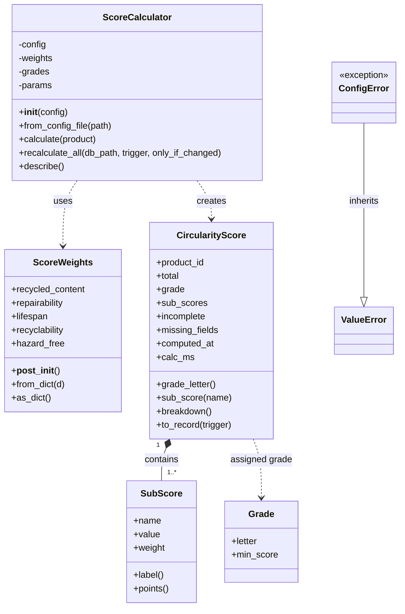
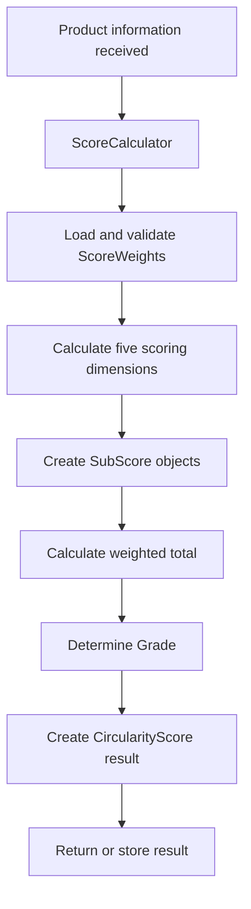
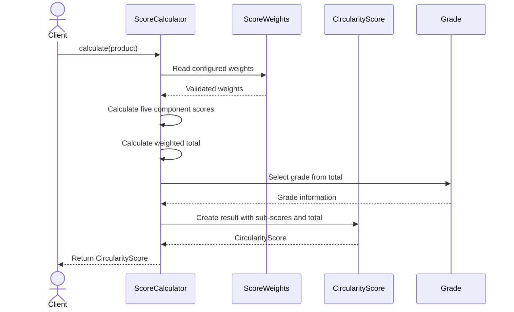

# Circularity Score Engine — UML Design

## 1. Subsystem overview

The **Circularity Score Engine (Subsystem 3)** evaluates a product's circularity using five weighted dimensions:

1. Recycled content
2. Repairability
3. Lifespan
4. Recyclability
5. Hazard-free materials

The engine calculates individual sub-scores, combines them into a total score, assigns a grade, and returns a structured result. It can also recalculate scores when product information changes.

> This document describes the UML structure of the Circularity Score Engine. Keep the class names and relationships aligned with the implementation in `circularity.py`.

## 2. Classes in the subsystem

| Class | Responsibility |
|---|---|
| `ScoreCalculator` | Main calculation component. Uses the configured weights and grading rules to calculate a product's circularity score. |
| `ScoreWeights` | Holds and validates the weights assigned to the five scoring dimensions. |
| `CircularityScore` | Represents the calculated result, including the total score, grade, sub-scores and missing-data information. |
| `SubScore` | Represents one scoring dimension, including its score and weight. |
| `Grade` | Represents a grade threshold and its corresponding grade letter. |
| `ConfigError` | Represents an invalid scoring-configuration error; inherits from Python's `ValueError`. |

## 3. UML class diagram

The following Mermaid class diagram can be rendered directly by GitHub in this Markdown file.



## 4. Class relationships

- **`ScoreCalculator` uses `ScoreWeights`:** the calculator reads the configured weights when calculating the weighted total.
- **`ScoreCalculator` creates `CircularityScore`:** after evaluating the product, it produces a result object.
- **`CircularityScore` contains `SubScore` objects:** each result includes the component scores used in the calculation.
- **`CircularityScore` references `Grade`:** the total score is mapped to a grade according to the configured thresholds.
- **`ConfigError` inherits from `ValueError`:** it provides a specific error type for invalid scoring configuration.

## 5. Scoring dimensions

The engine evaluates these five dimensions. The weights below reflect the current project scoring configuration described for this subsystem; if `score_config.json` changes, update this table to match it.

| Dimension | Weight |
|---|---:|
| Recycled content | 20% |
| Repairability | 25% |
| Lifespan | 20% |
| Recyclability | 25% |
| Hazard-free | 10% |
| **Total** | **100%** |

The weighted total is calculated from the five component scores and their configured weights. The result is bounded to the engine's defined score range and mapped to a grade using the configured grade thresholds.

## 6. Main scoring functions

The following are functions used by the subsystem, not separate classes:

| Function | Purpose |
|---|---|
| `recycled_content_score()` | Calculates the recycled-content component score. |
| `repairability_score()` | Calculates the repairability component score. |
| `lifespan_score()` | Calculates the lifespan component score. |
| `recyclability_score()` | Calculates the recyclability component score. |
| `hazard_free_score()` | Calculates the hazard-free component score. |

Helper functions such as `round1()`, `to_number()`, `clamp()`, `grade_for()` and `parse_config()` support validation, conversion, score bounding, grade selection and configuration parsing. They are functions rather than UML classes.

## 7. Calculation workflow



## 8. Sequence diagram



## 9. Configuration error handling

`ConfigError` is raised when the scoring configuration is invalid—for example, when required configuration values are missing or the weights fail validation. Since it inherits from `ValueError`, callers can handle it as either a specific `ConfigError` or a general value error.

## 10. Implementation and repository notes

- Main implementation: `circularity.py`
- Scoring configuration: `score_config.json`
- Score persistence/history: `score_store.py`

The persistence module is described separately because it uses functions rather than an additional class in the six-class UML model above.

### Suggested GitHub file layout

```text
your-project/
├── circularity.py
├── score_config.json
├── score_store.py
└── CIRCULARITY_ENGINE_UML.md
```

**Subsystem:** Circularity Score Engine (Subsystem 3)  
**Primary implementation file:** `circularity.py`
